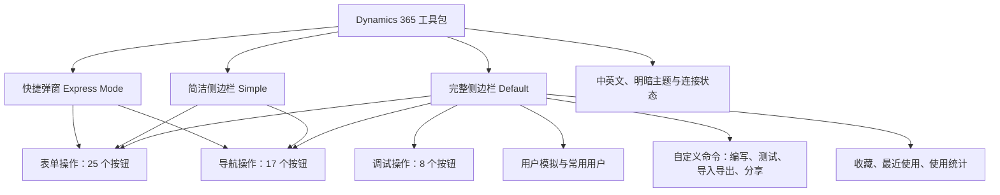
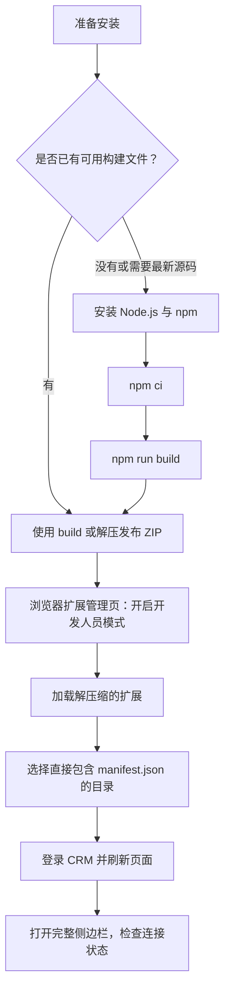
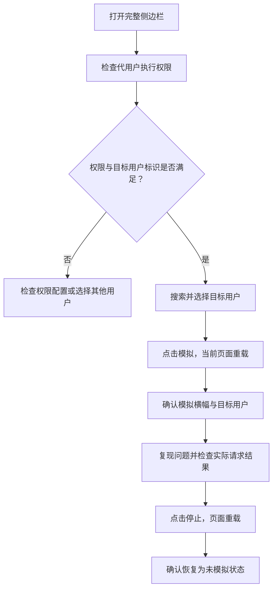
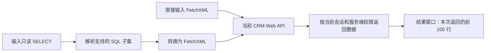
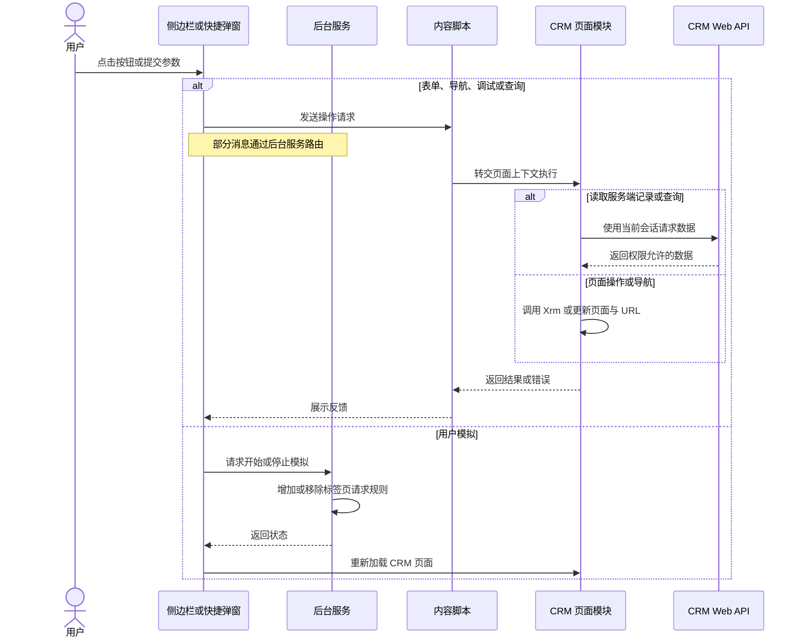

# Dynamics 365 工具包使用说明书

> 软件名称：**Dynamics 365 工具包.by Kenny Jin**
>
> 项目名称：Level Up for Dynamics 365 / Power Apps
>
> 对应版本：**4.1.3**，以当前仓库源码为依据
>
> 文档日期：2026 年 10 月 30 日

这是一款在浏览器中运行的 Dynamics 365 / Power Apps 辅助扩展，提供表单检查、记录导航、数据查询、调试、用户模拟和自定义 JavaScript 命令等功能。适合 CRM 开发人员、测试人员、实施顾问和系统管理员使用。

本文按当前界面介绍 **25 个表单按钮、17 个导航按钮、8 个调试按钮**，并覆盖用户模拟、自定义命令、收藏、最近使用、弹窗和底部工具栏。按钮以“中文名称 / English”标注；部分弹窗或按钮仍显示英文。若已安装的构建包早于当前源码，请先重新构建、重新加载扩展，再对照本说明使用。

## 目录

- [1. 软件概览与功能架构](#1-软件概览与功能架构)
- [2. 安装、更新与卸载](#2-安装更新与卸载)
- [3. 第一次使用](#3-第一次使用)
- [4. 界面与通用控件](#4-界面与通用控件)
- [5. 表单按钮说明](#5-表单按钮说明)
- [6. 导航按钮说明](#6-导航按钮说明)
- [7. 调试按钮说明](#7-调试按钮说明)
- [8. 用户模拟](#8-用户模拟)
- [9. 自定义命令](#9-自定义命令)
- [10. FetchXML 与 SQL 查询示例](#10-fetchxml-与-sql-查询示例)
- [11. 常见使用流程](#11-常见使用流程)
- [12. 常见问题与限制](#12-常见问题与限制)
- [13. 数据保存与项目结构](#13-数据保存与项目结构)

## 1. 软件概览与功能架构

### 1.1 运行条件

| 项目 | 说明 |
| --- | --- |
| 浏览器 | 主要面向支持 Manifest V3 和侧边栏 API 的 Microsoft Edge / Google Chrome。完整功能以这两类浏览器为主要使用方式。 |
| 目标系统 | Dynamics 365 Customer Engagement / Dataverse 模型驱动应用，以及相应的 Power Apps 模型驱动应用页面。源码中的检测和接口主要面向 9.x 环境。 |
| 页面协议 | 当前扩展清单的页面匹配范围为 `https://*/*`。纯 HTTP 的本地 CRM 不在默认自动注入范围内。 |
| 登录状态 | 先在浏览器中登录目标 CRM 环境；扩展复用页面登录会话，无需单独填写 CRM 密码。 |
| 使用权限 | 数据读取、记录保存、配置修改等仍受 CRM 服务端权限约束。打开管理页不代表自动获得管理权限。 |
| 适用页面 | 表单按钮通常需要打开记录详情表单；导航按钮通常只需进入已识别的 CRM 应用页面。 |

名称中的 Power Apps 主要指提供 `Xrm` 上下文的模型驱动应用。不要把画布应用、Maker 门户首页或 Dynamics 365 Finance & Operations 页面视为全部按钮均可使用的页面。

### 1.2 功能架构



### 1.3 三种使用方式

| 使用方式 | 入口 | 提供的功能 |
| --- | --- | --- |
| 快捷弹窗 / Express Mode | 单击浏览器扩展图标，按当前清单默认打开弹窗 | 表单和导航操作、中英文切换、“切换完整侧边栏”。 |
| 完整侧边栏 / Default | 弹窗中的“切换完整侧边栏”，或页面右键菜单 | 表单、导航、调试、用户模拟、自定义命令、收藏和最近使用。 |
| 简洁侧边栏 / Simple | 侧边栏底部齿轮 → Simple / 简洁 | 保留表单和导航区域，隐藏用户模拟、自定义命令、调试、收藏和最近使用。 |

**首次使用建议进入完整侧边栏。** 快捷弹窗会压缩按钮文字，悬停可查看完整提示；SQL 查询建议始终通过完整侧边栏执行，原因见第 10 节。

## 2. 安装、更新与卸载

### 2.1 方式一：加载 GitHub 发布包

从 [v4.1.3 GitHub Release](https://github.com/Kenny-666/Power-Platform-Tool-Kit/releases/tag/v4.1.3) 下载 Chromium ZIP 安装包。使用发布包无需安装 Node.js。

1. 下载并解压 `level-up-vnext-chromium-v4.1.3.zip` 到固定位置。
2. 打开 Microsoft Edge 或 Google Chrome。
3. 在地址栏输入对应的扩展管理地址：
   - Edge：`edge://extensions/`
   - Chrome：`chrome://extensions/`
4. 开启“开发人员模式 / Developer mode”。
5. 点击“加载解压缩的扩展 / Load unpacked”。
6. 选择解压后的扩展目录（直接包含 `manifest.json` 的文件夹）。
7. 确认扩展列表出现 **Dynamics 365 工具包.by Kenny Jin**，并处于启用状态。
8. 在浏览器扩展菜单中把扩展固定到工具栏，方便打开。
9. 打开已登录的 CRM 页面，刷新页面后再使用扩展。

**选择的目录里必须直接存在 `manifest.json`。** 不要选择 ZIP 文件、项目根目录或 `src` 目录；`src` 中的 TypeScript / TSX 尚未编译，不能直接作为可运行扩展加载。已加载的目录需要保留，移动或删除会导致扩展失效。

要使用尚未发布的源码修改，请按下面的构建方式自行生成 `build`。

### 2.2 方式二：从当前源码构建后安装

需要本机具备 Node.js 和 npm。可选用 Node.js 22；这是项目 CI 列出的版本之一。实际依赖要求以安装时 npm 输出为准。

在 PowerShell 中执行：

```powershell
Set-Location '<项目根目录>'
node --version
npm --version
npm ci
npm run build
```

- `npm ci`：按 `package-lock.json` 安装依赖，需要可访问依赖源；会重建本地 `node_modules`。
- `npm run build`：编译扩展，重新生成 `build` 目录。
- 构建成功后，按 2.1 节加载 `build`。

如果 PowerShell 提示不允许执行 `npm.ps1`，可以把上述 npm 命令写成 `npm.cmd ci` 和 `npm.cmd run build`。

如需生成可分发 ZIP，执行：

```powershell
npm run pack
```

当前版本输出位置：

```text
release\chromium\4.1.3\level-up-vnext-chromium-v4.1.3.zip
```

`pack` 会先清理并重建 `build` 和 `release`。需要保留旧安装包时，先把它复制到其他目录。

### 2.3 安装流程图



### 2.4 站点访问权限

如果浏览器提示扩展需要访问当前 CRM 站点，在扩展详情页或工具栏菜单中允许访问该站点，然后刷新 CRM 页面。企业设备可能由管理员统一控制扩展安装和站点访问权限。

扩展清单中的权限用途如下：

| 权限 | 用途 |
| --- | --- |
| `activeTab`、`scripting` | 识别当前页面，并在 CRM 页面中执行操作。 |
| `sidePanel` | 显示浏览器侧边栏。 |
| `storage` | 保存语言、显示模式、自定义命令等本地配置。 |
| `contextMenus` | 提供页面右键菜单入口。 |
| `declarativeNetRequest` | 为用户模拟设置当前标签页的请求头规则。 |
| 可选 HTTPS 主机权限 | 按浏览器授权情况访问目标站点。 |

### 2.5 更新与卸载

**更新源码安装：** 重新执行 `npm run build`，进入扩展管理页点击该扩展的“重新加载”，再刷新 CRM 页面，并重新打开侧边栏。

**更新 ZIP 安装：** 将新 ZIP 解压到安装目录，重新加载扩展；如果改用了新目录，需要通过扩展管理页重新选择目录。

**卸载：** 先停止正在进行的用户模拟，按需导出自定义命令备份，再到扩展管理页点击“移除”。卸载或清理浏览器扩展数据可能删除本地配置。

### 2.6 Firefox 说明

项目提供 `npm run pack:firefox`，会生成 Firefox 专用包，并移除侧边栏和部分 Chromium 权限。它不提供与 Chromium 完整侧边栏相同的功能，因此本说明的主要安装与完整功能流程以 Edge / Chrome 为准。执行 Firefox 打包后，如需继续加载 Chromium `build`，应重新执行 `npm run build` 恢复 Chromium 清单。

## 3. 第一次使用

1. 登录 CRM，打开模型驱动应用，等待页面加载完成。
2. 打开一条已有记录，例如“客户 / Account”。
3. 点击工具栏扩展图标，在快捷弹窗中点击 **切换完整侧边栏**。也可在 CRM 页面空白处右键，选择 **打开 Dynamics 365 工具包.by Kenny Jin**。
4. 查看侧边栏底部连接状态：绿色表示已识别当前 CRM 页面，红色表示未连接；加载动画表示正在检查。
5. 点击底部 **English / 中文** 切换语言。
6. 在“表单”区域点击 **逻辑名称**，检查字段旁是否出现逻辑名称。
7. 点击 **清除名称**，移除刚才添加的名称标记。
8. 点击 **记录 ID**，在弹窗中点击 **复制 / Copy**，验证读取和复制功能。

完成以上步骤后，就可以按下面的按钮说明使用其他功能。

### 常用术语

| 术语 | 示例 | 填写原则 |
| --- | --- | --- |
| 表 / 实体逻辑名称 | `account`、`contact`、`new_project` | “按 ID 打开”“新建记录”“打开列表”和查询中使用逻辑名称。 |
| 字段逻辑名称 | `name`、`telephone1`、`new_projectcode` | “聚焦字段”“字段值”和查询中使用逻辑名称。 |
| 实体集名称 | `accounts`、`contacts` | Web API URL 使用的集合名称，可能与逻辑名称不同。 |
| GUID / 记录 ID | `12345678-1234-1234-1234-123456789abc` | 标识某条记录，不是业务单号。建议直接使用“记录 ID”按钮获取。 |
| 当前表单值 | 刚输入但尚未保存的客户名称 | 来自页面，可由“字段值”读取。 |
| 服务端值 | 上次保存的客户名称 | 来自 Web API，可由“显示所有字段”“原始 JSON”读取。 |

## 4. 界面与通用控件

### 4.1 底部工具栏与入口

| 按钮或控件 | 功能与操作 |
| --- | --- |
| 切换完整侧边栏 | 快捷弹窗中的文字入口，设置 Default 模式并打开浏览器侧边栏。 |
| English / 中文 | 切换界面语言，保存选择；侧边栏、快捷弹窗及已接入本地化的页面内提示使用该设置。部分文字仍可能为英文。 |
| 信息图标 `ⓘ` | 打开“使用统计 / Stats for Nerds”，查看操作计数、使用过的操作种类及热门操作。关闭按钮只关闭窗口。 |
| 齿轮图标 | 在 Default / 默认与 Simple / 简洁之间切换侧边栏显示模式。 |
| 太阳图标 | 将扩展自身界面切换为浅色主题。 |
| 月亮图标 | 将扩展自身界面切换为深色主题。 |
| 底部环境地址 | 点击打开 Power Platform 管理中心；在线环境能取得环境 ID 时尝试进入当前环境，无法取得时打开管理中心首页。本地环境也不应把此入口当作本地管理中心。 |
| 浏览器侧边栏关闭按钮 | 关闭侧边栏界面。正在模拟用户时，应先点击“停止”；关闭侧边栏本身不等于停止模拟。 |

**主题区别：** 底部太阳/月亮控制扩展界面；“调试”区域的 **启用深色模式** 给 CRM 页面添加 URL 标志，作用对象不同。

### 4.2 表单、导航、调试区域

| 控件 | 功能 |
| --- | --- |
| 区域标题 / 展开收起箭头 | 展开或收起该区域。 |
| 搜索框 | 按当前语言下的按钮名称及说明筛选本区域按钮。 |
| 搜索框 `×` / 清除搜索 | 清空搜索条件，重新显示本区域按钮。 |
| 方格图标 | 使用按钮网格布局。 |
| 列表图标 | 使用列表布局，方便查看按钮说明。 |
| 操作按钮主体 | 执行对应操作；需要输入的操作会打开对话框。 |
| 爱心图标 | 添加或取消操作收藏；收藏与执行是不同操作。 |

完整侧边栏中，收藏后的按钮会移到“收藏”区域，并从原操作区域中移除。找不到某个按钮时，先检查收藏、搜索条件和显示模式。快捷弹窗直接展示表单与导航按钮，不使用侧边栏的收藏过滤。

### 4.3 收藏与最近使用

| 控件 | 功能 |
| --- | --- |
| 收藏区域中的操作按钮 | 执行收藏的操作。 |
| 收藏按钮旁的爱心 | 取消收藏，使按钮回到原分类区域。 |
| 最近使用中的操作按钮 | 再次执行最近选择过的操作。 |
| 最近使用的清除图标 | 清空最近使用记录；不会删除自定义命令或 CRM 记录。 |
| 区域标题 / 箭头 | 展开或收起区域。 |

最近使用最多保留 5 个不同操作，加载时过滤超过 7 天的条目。统计基于本地记录，容量有限，且点击操作时就可能计数，因此不能作为全部操作历史、成功次数或 CRM 审计日志。

### 4.4 输入对话框与结果窗口

| 按钮或控件 | 功能 |
| --- | --- |
| 实体选择框 | 输入或选择实体；可用时加载元数据并展示实体选项。元数据加载失败时可填写逻辑名称。 |
| 记录 ID / 字段名 / 查询输入框 | 输入当前操作需要的参数。 |
| 打开记录 / 创建新记录 / 打开列表 / 聚焦 / 提交 | 提交输入并执行对应操作。新建记录只是打开新建表单，仍需在 CRM 中保存。 |
| 取消 / Cancel | 关闭输入框，不提交本次操作。 |
| 记录 URL / ID 窗口中的复制按钮 | 将窗口中的文本复制到剪贴板；也可手动选择文本复制。 |
| 结果窗口中的搜索框 | 筛选已加载到窗口的结果；不是重新向 CRM 查询。 |
| 结果窗口搜索框 `×` | 清空搜索；搜索框内按 Esc 也可清除搜索条件。 |
| 左侧分类列表 | 在多分类结果中切换，例如表流程、当前用户信息。 |
| 在新选项卡中打开 | 在支持此按钮的结果窗口中，把当前展示结果打开到新标签页；不会自动重查数据。 |
| 分页：首页、上一页、页码、下一页、末页 | 出现分页控件时浏览当前已加载结果，不代表后台继续下载全部记录。 |
| 结果中的流程名称链接 | 打开对应流程、业务规则或自定义 API 页面。 |
| 查找字段旁的 `↗` | 启用“查找快捷链接”后，在新窗口打开该查找字段当前关联的记录。 |
| `×` / Close | 关闭当前弹窗；不会自动保存 CRM 表单。 |

## 5. 表单按钮说明

使用前先打开记录详情表单。涉及 Web API、记录 URL、GUID 和原始 JSON 的操作，应使用已经保存、具有记录 ID 的记录。

### 5.1 查看字段、名称与记录信息

| 编号 | 按钮：中文 / English | 功能、输入与结果 |
| --- | --- | --- |
| F01 | **逻辑名称 / Logical Names** | 在可定位到的表单字段旁添加逻辑名称。新增名称可点击复制，适合开发和排查字段映射。实际覆盖范围受表单控件和页面结构影响。 |
| F02 | **清除名称 / Clear Names** | 移除扩展添加的逻辑名称标记，保留原字段标签；不会撤销上帝模式或其他页面变化。 |
| F03 | **已更改字段 / Changed Fields** | 根据当前表单的修改状态，高亮尚未保存的字段；反映页面改动，不是历史审计记录。再次点击会重新计算高亮。 |
| F04 | **记录 URL / Record URL** | 生成当前记录链接并显示文本弹窗，点击“复制”获取链接。建议用于已有记录。 |
| F05 | **记录 ID / Record ID** | 显示当前记录不带花括号的 GUID，点击弹窗“复制”获取。新建未保存记录可能没有有效 ID。 |
| F06 | **Web API / Web API** | 在新标签页打开当前记录的 Web API 地址，查看服务端返回的数据。依赖记录 ID 和读取权限。 |
| F07 | **选项集值 / OptionSet Values** | 展示表单上选项集控件的标签和数值编码，适合编写筛选、脚本和数据映射。没有相关控件时提示未找到选项集。 |
| F08 | **显示所有字段 / Show All Fields** | 从 Web API 读取当前记录返回的字段，以显示名称、逻辑名称、字段值组成可搜索表格。可包含未放在表单上的字段，但不等于列出实体的全部元数据字段。 |
| F09 | **原始 JSON / Raw JSON** | 以 JSON 文本展示通过 Web API 客户端获取的当前记录数据，适合核对原始属性和查找字段值。显示的是已保存数据。 |
| F10 | **实体信息 / Entity Info** | 展示当前实体逻辑名称、实体集名称和 Object Type Code 等元数据。元数据不可用时部分值可能缺失或使用回退值。 |
| F11 | **字段值 / Field Value** | 输入字段逻辑名称，如 `name`，读取当前表单字段值。查找字段会显示名称、实体类型和 ID；空值显示 `[NULL]`。可用于查看尚未保存的改动。 |
| F12 | **复制字段名称 / Copy Field Names** | 为可识别的字段标签绑定点击复制逻辑名称的行为。执行后再点击字段标签即可复制；页面重载后需重新启用。 |

### 5.2 操作表单与打开设计页面

| 编号 | 按钮：中文 / English | 功能、输入与结果 |
| --- | --- | --- |
| F13 | **上帝模式 / God Mode** | 将当前表单中可处理的控件设为可见、可编辑，展开隐藏选项卡和分区，并把客户端“必填”改为“非必填”。主要用于测试和排查。 |
| F14 | **刷新子网格 / Refresh Subgrids** | 刷新当前表单的子网格，查看相关记录列表变化。不会保存主记录；具体能刷新哪些控件取决于表单。 |
| F15 | **克隆记录 / Clone Record** | 把当前表单中部分有值字段作为参数传入新窗口中的同实体新建表单。检查新表单后自行保存，才会生成新记录。 |
| F16 | **不保存即刷新 / Refresh Without Save** | 调用不保存刷新，可能丢弃当前未保存内容；随后在当前表单会话中拦截自动保存和“保存并关闭”对应的保存模式。使用前确认可舍弃当前改动。 |
| F17 | **聚焦字段 / Focus Field** | 输入字段逻辑名称，把焦点移到对应控件。字段必须在当前表单上，隐藏或不支持聚焦的控件可能无法按预期定位。 |
| F18 | **填充必填字段 / Populate Required** | 仅用于新建表单，确认后为值为 `null` 的必填文本、多行文本和查找字段尝试填值。文本使用“测试内容”，查找字段尝试选取可读取的关联记录。不会自动保存。 |
| F19 | **打开表单编辑器 / Open Form Editor** | 打开当前表单的设计器。当前实现先尝试经典编辑器路由；在线环境在调用抛错时尝试 Maker 编辑器。需具备相应自定义权限。 |
| F20 | **表流程 / Table Processes** | 查询当前实体关联的活动流程，并按实时工作流、后台工作流、Flow、业务规则、业务流程、操作和绑定的自定义 API 分类展示。点击名称可进入详情或设计页面。 |
| F21 | **清除通知 / Clear Notifications** | 对支持该方法的字段控件调用清除通知。无法保证移除所有带特定标识的通知，也不会修复验证错误；脚本仍可能再次添加通知。 |
| F22 | **刷新功能区 / Refresh Ribbon** | 重新计算命令栏按钮的显示和可用性规则。适合修改表单值后检查按钮状态；不会发布解决方案或修改命令规则。 |
| F23 | **查找快捷链接 / Lookup Links** | 在可定位的查找控件旁添加 `↗`，点击可在新窗口打开关联记录。再次点击本按钮会移除快捷链接。字段无值时提示未选择记录。 |

三个容易误解的操作：

- **上帝模式的作用范围是客户端界面。** 即使按钮提示提到安全角色，它也不能授予服务端读取或保存权限，不能绕过字段级安全或服务端业务校验。完整重载页面可重新加载正常表单规则。
- **克隆记录不是完整数据复制。** 当前实现排除创建时间、修改时间、创建人、修改人和所有者；只处理当前表单加载的属性，值为 `0`、`false` 或空的字段可能被跳过，相关记录、附件和子网格数据不会自动复制，复杂字段还需检查。
- **填充必填字段会填写查找字段。** 当前实际实现已包含查找填充，与部分旧提示中的“非查找字段”描述不同。它不填充所有字段类型，也不保证通过全部业务校验；保存前务必检查自动选择的关联记录。

“不保存即刷新”之后如需恢复正常自动保存行为，应完整重载页面，重新加载表单；“清除标志”不会删除这个操作注册的表单保存处理程序。

### 5.3 查询按钮

| 编号 | 按钮：中文 / English | 功能、输入与结果 |
| --- | --- | --- |
| F24 | **执行 FetchXML / Execute FetchXML** | 粘贴完整 FetchXML 查询，提交后通过当前环境 Web API 查询，并显示可搜索结果窗口。根节点必须是 `<fetch>`，其中须包含有 `name` 的 `<entity>`。 |
| F25 | **执行 SQL 查询 / Execute SQL Query** | 在完整侧边栏中输入受支持的只读 `SELECT`，扩展先转成 FetchXML，再使用同一结果窗口展示。不是直接连接 SQL Server。 |

两者的结果表最多显示**本次返回数据的前 100 行**。当前没有自动遍历所有服务端分页；窗口标题里的计数来自当前 API 响应，不一定是整个查询的精确总量。查询例子和语法限制见第 10 节。

## 6. 导航按钮说明

这些按钮主要用于打开系统页面或新表单。能否访问目标页面，取决于 CRM 版本、应用、部署方式和当前用户权限。

| 编号 | 按钮：中文 / English | 功能与使用方法 |
| --- | --- | --- |
| N01 | **用户信息 / User Info（配置名 Current User）** | 查看当前登录上下文的用户名称、用户 ID、语言、安全角色与所属团队。用户模拟期间不能仅凭这个窗口判断所有请求均已切换为目标用户。 |
| N02 | **按 ID 打开 / Open by ID** | 输入实体逻辑名称和记录 GUID，打开对应记录。侧边栏用同一个对话框输入；快捷弹窗依次询问 ID 和实体名称。 |
| N03 | **新建记录 / New Record** | 选择或填写实体逻辑名称，打开该实体的新建表单。填表并保存后才创建记录。 |
| N04 | **打开列表 / Open List** | 选择或填写实体逻辑名称，打开该实体的记录列表。 |
| N05 | **安全性 / Security** | 打开安全角色 `role` 列表，查看或管理安全角色。当前实现是角色列表入口。 |
| N06 | **系统作业 / System Jobs** | 打开 `asyncoperation` 列表，查看异步系统作业、工作流运行及错误。 |
| N07 | **解决方案 / Solutions** | 优先打开当前 CRM 的经典解决方案管理页；在线环境在导航调用抛错时回退到 Maker 解决方案页。本地部署保留本地路由。 |
| N08 | **流程 / Processes** | 打开 `workflow` 列表，查看工作流、操作等流程定义。与“表流程”不同，这里是系统列表入口。 |
| N09 | **邮箱 / Mailboxes** | 打开 `mailbox` 列表，查看邮箱配置和处理状态。修改配置需具备相应权限。 |
| N10 | **打开主页 / Open Main（配置名 Home）** | 打开当前组织的 Dynamics 主页。 |
| N11 | **高级查找 / Advanced Find** | 打开高级查找入口。是否显示经典或其他查找体验，取决于目标 CRM 环境。 |
| N12 | **移动客户端 / Mobile Client** | 打开组织对应的移动 Web 客户端路由。旧客户端路由是否仍可用取决于环境。 |
| N13 | **解决方案历史记录 / Solution History（配置名 Solutions History）** | 在当前组织打开 `msdyn_solutionhistory` 列表，查看解决方案导入等历史。目标环境需要存在该表和可访问视图。 |
| N14 | **插件跟踪日志 / Plugin Trace Logs** | 打开 `plugintracelog` 列表，用于分析插件执行异常。是否存在日志还取决于环境的跟踪配置。 |
| N15 | **环境变量 / Environment Variables** | 打开 `environmentvariabledefinition` 列表，查看环境变量定义；实际值需按系统页面提供的关联入口查看和维护。 |
| N16 | **导入解决方案 / Import Solution** | 打开当前组织的经典解决方案导入向导。点击按钮本身不上传或导入文件，后续需在向导中选择文件并确认。 |
| N17 | **固定到侧边栏 / Pin to Side Panel** | 使用 CRM 的 `Xrm.App.sidePanes`，把当前记录或列表打开到应用内部侧窗。需要环境支持该 API。 |

**两个“侧边栏”不同：** “切换完整侧边栏”打开浏览器扩展工具栏；“固定到侧边栏”打开 CRM 应用内部的业务页面侧窗。

## 7. 调试按钮说明

调试区域仅在完整侧边栏显示。它主要通过添加 URL 参数让 CRM 运行时启用特定行为，因此通常会重新加载页面。使用前保存需要保留的内容。

| 编号 | 按钮：中文 / English | 实际行为与参数 |
| --- | --- | --- |
| D01 | **表单监视器 / Forms Monitor** | 添加 `monitor=true`，由 CRM 运行时决定是否显示监视工具；若已存在该值，再次点击会重载页面。 |
| D02 | **命令检查器 / Command Checker** | 添加 `ribbondebug=true`，请求启用命令栏调试体验，便于检查显示及启用规则。 |
| D03 | **性能中心 / Perf Center** | 添加 `perf=true`，请求启用 CRM 性能诊断入口。具体入口和可用性依赖环境。 |
| D04 | **禁用表单处理程序 / Disable Form Handlers** | 添加 `flags=DisableFormHandlers%3Dtrue`，请求运行时禁用表单事件处理程序，排查脚本事件影响。 |
| D05 | **禁用业务规则 / Disable Business Rules** | 添加 `flags=DisableFormHandlers%3Dbusinessrule`，请求运行时禁用客户端业务规则处理。不会停用服务端业务逻辑。 |
| D06 | **禁用表单库 / Disable Form Libraries** | 添加 `flags=DisableFormLibraries%3Dtrue`，请求运行时停止加载相关表单 JavaScript 库。 |
| D07 | **启用深色模式 / Enable Dark Mode** | 添加 `flags=themeoption%3Ddarkmode`，请求 CRM 页面使用深色模式；与扩展底部主题按钮不同。 |
| D08 | **清除标志 / Clear Flags** | 按当前实现从 URL 中移除一个匹配的 `flags` 参数并导航；不会清除 `monitor`、`ribbondebug` 和 `perf`。存在多个 `flags` 时可能需要重复操作。 |

URL 调试参数需要目标 CRM 版本支持。按钮成功添加参数，并不保证该版本一定出现相应诊断界面。

### 完整恢复调试状态

1. 在地址栏检查 URL。
2. 删除不再需要的 `flags`、`monitor`、`ribbondebug`、`perf` 参数，保留组织地址、`appid`、`etn`、记录 `id` 等正常导航参数。
3. 重新打开清理后的地址。
4. 如仍需验证，关闭该记录页面后从正常列表重新进入。

## 8. 用户模拟

### 8.1 用途和前提

用户模拟用于协助复现特定用户的数据访问和 API 行为。它要求当前用户具有 **代其他用户执行操作 / `prvActOnBehalfOfAnotherUser`** 权限；系统管理员通常具备该权限，但应以环境实际配置为准。

目标用户还必须具备有效的 **Azure AD / Microsoft Entra Object ID**。纯本地用户或未同步该标识的用户可能无法使用此功能，不能把本地部署路由支持等同于本地用户模拟也完全支持。

### 8.2 每个控件的作用

| 按钮或控件 | 功能 |
| --- | --- |
| 搜索用户 / Search Users | 输入姓名、电子邮件或域账号等关键字；至少输入 2 个字符后进行搜索。结果较多时继续缩小关键词。 |
| 下拉用户项 | 选择要模拟的用户，核对姓名和邮件地址。 |
| 用户旁的星标 | 添加或移除常用用户。当前常用用户最多保留 10 个，方便下次快速选择。 |
| 已选用户的清除控件 | 取消当前选择，重新选择目标用户。 |
| 提示 / Tips | 显示搜索建议，帮助缩小结果。 |
| 模拟 / Impersonate | 对当前标签页开始用户模拟，并刷新当前 CRM 页面。 |
| 停止 / Stop | 移除当前标签页的模拟规则，并刷新页面恢复。 |
| 重试检查 / Retry Check | 出现权限不足提示时，重新检查当前用户的模拟权限。 |
| 错误提示 `×` | 关闭当前错误信息，不代表已停止模拟。 |
| Active / Inactive 状态 | 显示当前标签页是否处于模拟状态。模拟时还会显示目标用户名称，工具栏图标可能带姓名缩写角标。 |

### 8.3 使用流程



### 8.4 作用边界

模拟通过浏览器会话规则，为**当前标签页、当前主机、匹配 `/api/data/v*` 的请求**设置 `CallerObjectId` 请求头。它不等于退出并重新登录目标用户，也不保证页面中所有 UI、缓存、旧接口和外部请求都以目标用户身份运行。

- 新打开的标签页或窗口不应假定自动继承模拟。
- 导航或页面行为可能影响模拟状态，测试时要持续核对横幅。
- 关闭侧边栏或切换 Simple 模式只隐藏界面，不是停止操作。应先点击 **停止**。
- 关闭目标标签页时，后台会清理其模拟规则；扩展启动时也会执行清理。
- 测试真实权限边界时，仍应使用目标用户独立登录进行最终确认。

## 9. 自定义命令

完整侧边栏的“命令 / Commands”区域允许把常用 JavaScript 保存成按钮，在当前 CRM 页面中执行。命令可以调用 `Xrm` 等页面 API。

### 9.1 命令区域的按钮

| 按钮或控件 | 功能 |
| --- | --- |
| 新建命令 / `+` / Create Command | 打开命令编辑器，创建本地自定义命令。 |
| 命令图标按钮 | 立即执行该命令；实际效果取决于代码，可能读取或修改 CRM 数据。 |
| 命令旁的 `⋮` | 打开该命令的操作菜单。 |
| 编辑 / Edit | 修改命令名称、说明、图标或代码。 |
| 删除 / Delete | 打开删除确认框；再次确认后删除本地命令，不撤销该命令过去执行产生的 CRM 数据变化。 |
| 导出命令 / Export Commands | 把当前命令集合下载为 JSON 文件，文件名形如 `level-up-commands-2026-10-30.json`。 |
| 导入命令 / Import Commands | 打开导入窗口，粘贴导出的 JSON，选择需要导入的命令。 |
| 分享集合 / Share Collection | 打开四步向导，整理命令集合资料，再打开预填的 GitHub Issue 表单。 |
| 区域标题 / 箭头 | 展开或收起命令列表。 |

### 9.2 编辑器的字段和按钮

| 字段或按钮 | 说明 |
| --- | --- |
| 命令名称 / Command Name | 必填；保存后显示在命令按钮或提示中。 |
| 图标 / Icon | 选择命令按钮使用的图标。 |
| 说明 / Description | 可选，用于解释命令用途。 |
| JavaScript 代码编辑区 | 输入代码；默认上限为 500 行，显示基本检查错误和警告。 |
| `Ctrl+Space` | 打开代码补全；输入 `Xrm` 时可查看相关补全提示。 |
| 快速参考代码片段 | 将对应代码追加到编辑区末尾，使用前补充所需参数。 |
| Test Code | **在当前真实页面执行代码**并显示执行反馈，不是单纯检查语法。 |
| 创建命令 / Create Command | 保存新命令。 |
| 更新命令 / Update Command | 保存对已有命令的修改。 |
| Cancel / 右上角 `×` | 关闭编辑器，放弃尚未保存的命令修改。 |

“测试成功”主要表示执行入口没有捕获到同步错误。当前执行方式不会完整等待命令自行启动的全部异步任务，所以仍需检查页面、控制台和接口结果；也不应把基本代码检查当作隔离沙箱或完整的 JavaScript 编译检查。

### 9.3 创建一个只读取信息的示例

1. 在 CRM 中打开一条已保存的记录。
2. 点击命令区域 `+`，名称填写“查看当前记录摘要”。
3. 输入以下代码：

```javascript
const entity = Xrm.Page.data.entity;
const summary = {
  entityName: entity.getEntityName(),
  recordId: entity.getId(),
  hasUnsavedChanges: entity.getIsDirty()
};
console.log('当前记录摘要', summary);
Xrm.Navigation.openAlertDialog({
  text: JSON.stringify(summary, null, 2)
});
```

4. 点击 **Test Code**，查看 CRM 页面出现的提示框。
5. 点击 **创建命令**。
6. 以后打开记录，点击这个命令即可再次查看摘要。

如果当前页面没有表单上下文，示例中的 `Xrm.Page.data.entity` 可能不可用；应切换到记录详情表单。

### 9.4 导入和导出

**备份：** 点击“导出命令”，保留下载的 JSON。

**恢复或迁移：** 点击“导入命令”，用文本编辑器打开备份 JSON 并复制全文，粘贴到导入窗口。不要只粘贴其中一段 JavaScript。

| 导入控件 | 功能 |
| --- | --- |
| JSON 输入框 | 粘贴包含 `commands` 数组的导出数据，窗口解析后显示候选命令。 |
| 命令复选框 | 选择本次要导入的命令。 |
| 全选 / 取消全选 | 批量选择或取消候选项。 |
| “我了解风险，并已审阅……”复选框 | 确认已经检查即将导入的代码；未勾选时不能执行导入。 |
| 导入若干个命令 | 导入选中的命令。默认跳过与已有命令同名的项，无覆盖开关。 |
| 取消 / `×` | 关闭导入窗口。 |

当前界面的成功提示可能按所选数量显示；同名、无效或检查失败的命令可能被跳过，导入后应以命令列表实际新增项为准。

### 9.5 分享集合

分享向导分为：**选择命令 → 集合详情 → 安全与质量 → 预览并分享**。

| 步骤或按钮 | 功能 |
| --- | --- |
| 选择命令 / 全选 / 取消全选 | 指定要放入集合的命令。 |
| 集合详情 | 填写集合名称、至少 50 字符的说明、主要类别、作者；还可填写标签、测试版本、联系信息。 |
| 安全与质量复选框 | 确认命令经过测试、不含敏感信息、代码符合要求。 |
| 上一步 / Back | 返回上一步调整。 |
| 下一步 / Next | 检查当前页必填信息后继续。 |
| 打开 GitHub Issue 表单 | 把集合说明和命令 JSON 预填到浏览器新标签页的 GitHub Issue 表单中。 |
| 完成页再次打开 Issue 表单 | 首次未打开或被拦截时，再次打开表单。 |
| 取消 / 关闭 | 关闭向导。 |

当前默认目标是源码配置的 `rajyraman/level-up-community-commands` 仓库。扩展打开表单后，还需要用户登录 GitHub、核对内容并自行提交；扩展内的“分享完成”提示并不表示 Issue 已经发布。

分享会把所选代码和资料带到 GitHub 页面。提交前检查是否包含内部地址、密钥、真实客户资料或不宜公开的业务逻辑。

> 当前主界面没有挂载独立的“社区命令浏览器”“GitHub 集成设置”或“管理员操作面板”。仓库虽有相关组件文件，但本文不将其列为可直接点击的界面入口。

## 10. FetchXML 与 SQL 查询示例

### 10.1 执行 FetchXML

在完整侧边栏点击 **执行 FetchXML**，粘贴以下查询，再点击 **提交**：

```xml
<fetch top="20">
  <entity name="account">
    <attribute name="accountid" />
    <attribute name="name" />
    <attribute name="accountnumber" />
    <filter>
      <condition attribute="statecode" operator="eq" value="0" />
    </filter>
    <order attribute="name" descending="false" />
  </entity>
</fetch>
```

这会查询当前用户可读取的活动客户，最多请求 20 条，并按名称排序。若环境没有该表、字段或读取权限，改用环境中实际存在的逻辑名称。

### 10.2 执行 SQL 查询

在**完整侧边栏**点击 **执行 SQL 查询**，输入：

```sql
SELECT TOP 20 accountid, name, accountnumber
FROM account
WHERE statecode = 0
ORDER BY name ASC
```

SQL 在浏览器端转成 FetchXML，后续使用当前 CRM 的 Web API，不要求额外配置数据库连接或数据库密码。



### 10.3 SQL 支持范围

| 语法 | 当前支持情况 |
| --- | --- |
| `SELECT 字段1, 字段2 FROM 实体` | 支持；必须明确填写逻辑字段名。 |
| `TOP n` / `TOP (n)` | 支持，`n` 为 1～5000 的整数；展示窗口仍最多显示前 100 行。 |
| `WHERE` | 支持简单条件。 |
| `=`、`<>`、`!=`、`>`、`>=`、`<`、`<=` | 支持。 |
| `LIKE` / `NOT LIKE` | 支持，例如 `name LIKE 'A%'`。 |
| `IN` / `NOT IN` | 支持，例如 `statecode IN (0, 1)`。 |
| `IS NULL` / `IS NOT NULL` | 支持。 |
| 多个条件使用 `AND` 或 `OR` | 支持同一类连接符；不支持在同一 WHERE 中混用两者。 |
| `ORDER BY` | 支持一个或多个字段，以及 `ASC` / `DESC`。 |
| 字符串 | 使用单引号；值中的单引号写成两个，例如 `'O''Brien'`。 |
| 数字、`true`、`false` | 支持作为简单条件值。 |
| `SELECT *` | 不支持。 |
| JOIN、别名、函数、聚合、GROUP BY、子查询、复杂括号条件 | 不支持。需要更复杂的查询时使用合适的 FetchXML。 |
| INSERT、UPDATE、DELETE、多条 SQL | 不支持。当前 SQL 入口只接受一条只读 SELECT。 |

当前解析器对 WHERE 的识别较简单；多条件建议用普通空格分隔，把 WHERE 条件写在同一行。字段和值保持简单，不要把它当作完整 SQL 引擎。

**快捷弹窗限制：** 当前快捷弹窗会显示 SQL 按钮，但其输入处理尚未为 SQL 收集查询文本，点击可能返回缺少查询内容的错误。请点击“切换完整侧边栏”后执行 SQL。

**结果限制：** 搜索、分页和“在新选项卡中打开”只处理已展示的数据，不能突破前 100 行或服务端分页范围。需要全量数据时，应使用专门的数据导出工具，不能把此窗口当作全量导出。

## 11. 常见使用流程

### 11.1 排查字段为什么不显示或不可编辑

1. 打开目标记录，使用 **逻辑名称** 确认字段身份。
2. 使用 **字段值** 查看页面内的值，用 **显示所有字段** 核对已保存的值。
3. 在测试环境使用 **上帝模式**，观察字段是否能显示、编辑。
4. 通过 **表流程** 查找相关业务规则、流程。
5. 如需判断脚本来源，分别使用 **禁用业务规则**、**禁用表单处理程序**或**禁用表单库**，每次只改变一项并重现问题。
6. 清理调试参数，完整重载页面后复核。

### 11.2 根据 GUID 定位记录

1. 点击 **按 ID 打开**。
2. 填实体逻辑名称，例如 `account`。
3. 填记录 GUID，点击 **打开记录**。
4. 使用 **记录 URL** 分享链接；接收者仍需登录且有读取权限。

### 11.3 查看插件异常

1. 先复现目标操作并记下时间与记录 ID。
2. 点击 **插件跟踪日志**。
3. 在 CRM 列表中按时间、插件名称等筛选。
4. 同时查看 **系统作业**，排查后台异步任务失败。
5. 如果没有跟踪日志，检查环境是否启用相应跟踪级别及当前账号是否有读取权限。

### 11.4 快速准备测试数据

1. 点击 **新建记录** 并选择实体。
2. 在新建表单点击 **填充必填字段**，确认填入测试值。
3. 检查每一个自动填写的查找字段，补全其他业务必填项。
4. 手动保存测试记录。
5. 需要类似数据时使用 **克隆记录**，检查新表单中未复制或不适合沿用的字段，再保存。

### 11.5 复现特定用户问题

1. 打开完整侧边栏，搜索目标用户并开始 **模拟**。
2. 确认页面刷新后的模拟横幅。
3. 在当前标签页复现数据读取或 API 行为，记录结果。
4. 点击 **停止**，确认页面刷新并恢复。
5. 涉及完整 UI 或最终权限判断时，用目标用户独立登录复核。

## 12. 常见问题与限制

| 现象 | 原因与处理 |
| --- | --- |
| 加载扩展提示找不到清单或脚本 | 选中 `build` 或 ZIP 解压后直接包含 `manifest.json` 的目录；不要加载源码根目录或 `src`。 |
| 点击扩展图标只出现小弹窗 | 这是快捷弹窗；点击“切换完整侧边栏”，或使用 CRM 页面右键菜单。 |
| 侧边栏红灯、显示未连接 | 切回已登录的 CRM 应用，等待页面加载，刷新后重开侧边栏；检查站点访问权限。普通网页、浏览器内部页和没有 Xrm 上下文的门户页不适用。 |
| 页面是 HTTP 的本地 CRM | 当前清单自动匹配 HTTPS，HTTP 不在默认范围内。应先确认环境是否可通过 HTTPS 访问。 |
| 表单按钮提示只能在表单使用 | 当前可能是列表、仪表板或其他非记录页面。打开一条记录详情再操作。 |
| 扩展更新后仍显示旧按钮 | 重新构建或更换新构建文件，扩展管理页点击重新加载，再刷新 CRM 页面；已注入页面的旧脚本需要刷新才能替换。 |
| 找不到调试、用户模拟或命令区域 | 底部齿轮切换到 Default / 默认模式；部分功能还受连接状态或权限检查影响。 |
| 某个按钮从原分类中消失 | 先检查“收藏”区域，再清除搜索条件。收藏按钮会从原分类移走。 |
| 上帝模式后仍不能保存或读取字段 | 客户端解锁不会改变服务端权限、字段安全、插件验证或计算字段规则。应检查真实权限与数据校验。 |
| “显示所有字段”和“字段值”不一致 | 前者读服务端已保存数据，后者读页面内当前值。先确认是否存在未保存改动。 |
| 显示所有字段缺少某些字段 | 该窗口展示 API 返回的属性，不是全实体字段元数据清单；空值、不可读属性或特定类型可能不返回。 |
| 克隆没有复制完整 | 当前只通过新建表单参数传递部分属性；核对 0、false、所有者、复杂类型、附件和关联记录，见 F15 说明。 |
| 填充必填字段填得不完整 | 仅处理新建表单上为空的必填文本和查找字段。其他字段类型、无可用关联数据或读取失败时需要手工补全。 |
| 复制失败 | 检查浏览器剪贴板权限和 HTTPS；记录 ID / URL 可从文本弹窗手动复制。 |
| 新窗口或结果新标签没有出现 | 检查浏览器弹出窗口拦截；允许目标 CRM 站点打开所需窗口后重试。 |
| 本地环境的管理页、表流程报错 | 经典路由、系统表和 Custom API 支持因版本而异。本地部署路由适配不等于所有新版本功能都存在。 |
| 打开表单编辑器或解决方案页后出现错误页 | 当前在线回退依赖导航调用抛出异常；目标页面打开后返回 404 不一定触发回退。可从该环境支持的正常设计入口进入。 |
| 点击清除标志后调试还在 | 当前仅移除匹配的 `flags`，不会清理全部调试参数。按第 7 节完整恢复步骤手动清理。 |
| 用户模拟提示无权限 | 核对 `prvActOnBehalfOfAnotherUser` 权限和目标用户对象 ID，必要时点击“重试检查”。 |
| 模拟后界面用户名称未完全变化 | 该功能主要改写特定 Web API 请求，不是原生登录切换；应查看模拟横幅和实际请求结果。 |
| 自定义命令无法创建或测试 | 检查名称、空代码、500 行上限和编辑器基本检查；确认页面存在所用 Xrm API。 |
| Test Code 成功但异步操作失败 | 当前执行入口不会完整等待自行启动的异步任务；检查控制台和接口错误，并在代码中处理异步异常。 |
| 导入提示成功但数量少 | 同名命令、无效命令可能被跳过，提示数不一定是实际导入数。核对命令列表，必要时修改命令名称后导入。 |
| SQL 点击后提示缺少内容 | 使用完整侧边栏的 SQL 输入框；当前快捷弹窗未收集 SQL 文本。 |
| SQL 不识别语句 | 使用明确逻辑字段名和简单 SELECT；不支持 SELECT *、JOIN、聚合或混用 AND/OR。 |
| 查询结果只有一部分 | 窗口最多显示本次返回的前 100 行，且未自动读取所有后续页；减少 TOP 和筛选范围，勿将结果窗口当作全量导出。 |
| GitHub 分享显示完成，但没有 Issue | 扩展只打开预填表单，需在 GitHub 中核对并手动提交。 |
| Mermaid 显示为代码 | 当前 Markdown 查看器可能不支持 Mermaid；可在支持 Mermaid 的 Markdown 预览器中打开本文件，正文与表格仍可直接阅读。 |

## 13. 数据保存与项目结构

### 13.1 数据保存范围

| 数据 | 主要保存位置与说明 |
| --- | --- |
| 语言与显示模式 | 浏览器扩展本地存储，另有 localStorage 回退。 |
| 收藏与最近使用 | 扩展页面的 localStorage；最近使用不是审计历史。 |
| 自定义命令 | 浏览器扩展本地存储及 localStorage 回退；可手工导出 JSON 迁移。 |
| 常用模拟用户 | 本机浏览器扩展相关存储，用于快速选择用户。 |
| 用户模拟状态 | 后台内存和浏览器会话请求规则，按标签页管理。 |
| CRM 业务记录 | 仍在原 CRM / Dataverse 环境；扩展通过当前会话访问。 |
| 分享的命令 | 打开 GitHub 表单时带入所选代码和说明，最终发布由用户在 GitHub 完成。 |

切换浏览器、浏览器配置文件、重新安装扩展或更改扩展身份后，不应假定配置会自动同步。自定义命令建议定期导出备份。

### 13.2 技术运行架构



### 13.3 关键文件位置

以下路径相对于本项目根目录，方便后续维护说明书时核对实现。

| 文件或目录 | 用途 |
| --- | --- |
| `src/manifest.json` | 扩展名称、版本、权限和页面匹配范围。 |
| `src/sidebar/sidebar.tsx` | 侧边栏主界面、区域组合和输入操作。 |
| `src/popup/popup.tsx` | 快捷弹窗与侧边栏切换入口。 |
| `src/sidebar/config/actions.ts` | 三组主要按钮及其动作 ID；本说明的 50 个按钮以此为清单。 |
| `src/localization/i18n.ts` | 中英文界面名称与翻译。 |
| `src/content/modules/form-actions.ts` | 表单操作、字段查看、克隆、FetchXML 和 SQL 调用。 |
| `src/content/modules/sql-to-fetchxml.ts` | 支持的 SQL 语法与转换规则。 |
| `src/content/modules/navigation-actions.ts` | 记录与系统页面导航、本地部署路由。 |
| `src/content/modules/debugging-actions.ts` | 调试 URL 参数与清理行为。 |
| `src/content/modules/table-dialog.ts` | 结果表格、搜索、分页与新标签页。 |
| `src/content/modules/custom-commands.ts` | 自定义 JavaScript 的页面执行入口。 |
| `src/services/CustomCommandsService.ts` | 命令保存、校验、导入和导出。 |
| `src/services/ImpersonationService.ts` | 标签页模拟规则与清理。 |
| `src/background/background.ts` | 后台消息、右键菜单与侧边栏管理。 |
| `vite.config.ts` | 编译和复制扩展资源。 |
| `scripts/package.js` | ZIP 打包及 Firefox 清单转换。 |
| `build/` | 浏览器可加载的构建结果。 |
| `release/` | 打包输出目录。 |

本说明依据当前工作区的实现编写；当按钮或行为变化时，应同时核对按钮配置、界面入口和具体执行模块，不能只根据按钮提示推断功能。
